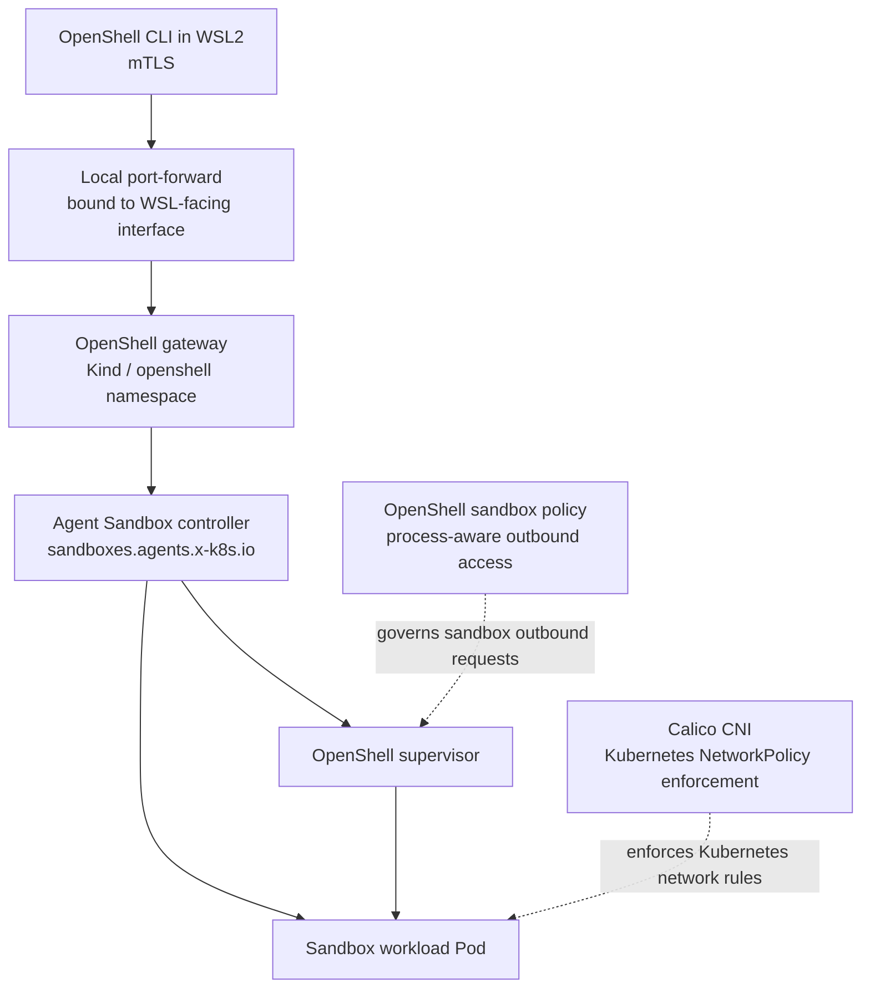
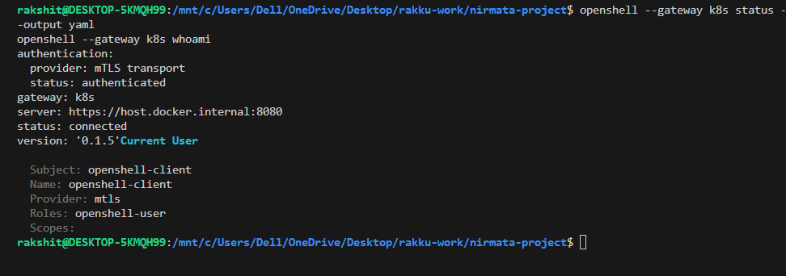
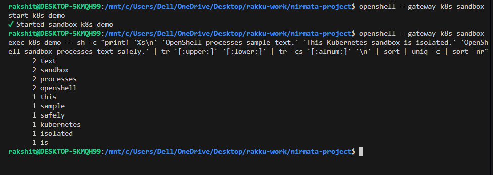
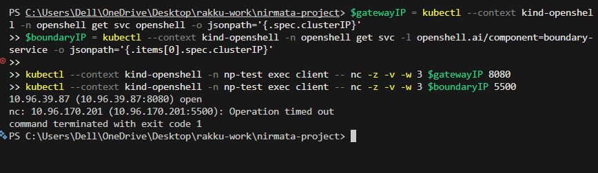
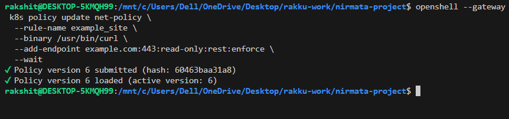
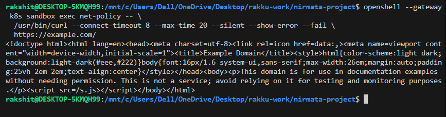

# NVIDIA OpenShell on Kubernetes

**A local, Kubernetes-backed sandbox demo for NVIDIA OpenShell.**

This project shows OpenShell creating and governing workloads in a local
[Kind](https://kind.sigs.k8s.io/) cluster—not just running a standalone Docker
gateway. It demonstrates sandbox command execution, a restricted sandbox
boundary, and destination-specific outbound network policy.

> **Scope:** This is a single-node Windows/WSL2 development demo, not a
> production deployment or a complete security assessment. The tests cover
> specific controls and paths; they do not certify every possible escape or
> network path.

## What the demo shows

| Demonstration | What was observed |
| --- | --- |
| **Kubernetes sandbox execution** | A text-processing command ran through the OpenShell CLI inside a sandbox workload Pod. |
| **Sandbox network boundary** | A probe Pod connected to the OpenShell gateway; access to a sandbox boundary service restricted to its supervisor timed out. |
| **OpenShell outbound policy** | A sandbox-scoped rule allowed read-only HTTPS requests from `/usr/bin/curl` to `example.com:443`; a request to `api.github.com` remained denied. Policy and supervisor logs were checked for these outcomes. |
| **Gateway authentication** | The CLI connected to the Kubernetes gateway using mTLS. |

The outbound rule is scoped to the `net-policy` sandbox; it is not a global
gateway rule. A connection timeout on its own is not proof of a policy denial:
the outbound test was checked against OpenShell policy and enforcement logs.

## Architecture



OpenShell's Kubernetes compute driver provisions the sandbox resources. The
Agent Sandbox controller manages the sandbox workload, while Calico enforces
Kubernetes NetworkPolicies. OpenShell's sandbox policy is a separate layer
that controls the tested process-to-destination requests.

## Verified environment

The documented setup used:

- Windows with Docker Desktop and WSL2 Ubuntu
- Kind cluster `openshell`, Kubernetes `v1.36.1`
- Calico `v3.31.3`
- NVIDIA OpenShell CLI and Helm chart `0.1.5`
- Kubernetes Agent Sandbox controller and
  `sandboxes.agents.x-k8s.io` CRD
- mTLS-authenticated CLI access to the Kubernetes gateway

The cluster and gateway verification and three demonstrations were performed
on **2026-10-23**. This describes recorded results, not the live state of your
cluster today.

## Getting started

This repository contains the cluster configuration and repeatable commands;
it does **not** contain a running cluster, gateway credentials, certificates,
or kubeconfig. You need Docker Desktop with WSL2 integration, Kind, kubectl,
Helm 3, and the OpenShell CLI. Follow the detailed
[Windows/WSL2 setup and recovery guide](./OPEN-SHELL-KUBERNETES.md) to configure
the cluster, CNI, controller, gateway, TLS access, and policy.

### Run a sandbox command

After setup, select the project context and check the gateway from WSL Ubuntu:

```powershell
kubectl config use-context kind-openshell
kubectl --context kind-openshell get nodes
```

```bash
openshell --gateway k8s status
openshell --gateway k8s sandbox list
openshell --gateway k8s sandbox start k8s-demo
openshell --gateway k8s sandbox exec k8s-demo -- id
```

The `k8s-demo` sandbox runs a harmless sleep process so it can accept commands.
If it does not exist, the guide includes the creation command. To see all
three demonstrations—including the Calico boundary probe and the
allow/deny policy test—follow [Three short project demos](./OPEN-SHELL-KUBERNETES.md#three-short-project-demos).

## Screenshots

### Authenticated Kubernetes gateway



### Command executed inside a Kubernetes sandbox



### Sandbox network boundary



### OpenShell outbound policy loaded



### Allowed outbound request



## Repository contents

| Path | Purpose |
| --- | --- |
| [`OPEN-SHELL-KUBERNETES.md`](./OPEN-SHELL-KUBERNETES.md) | Architecture, setup, recovery, demos, verification notes, limitations, and cleanup. |
| [`kind-config.yaml`](./kind-config.yaml) | Kind configuration with the default CNI disabled for Calico installation. |
| [`screenshots/`](./screenshots/) | Selected screenshots of recorded demo results. |

## Safety and cleanup

- Only use the `kind-openshell` context for this project. Do not target other
  Kind clusters.
- The gateway port-forward is local and bound to the WSL-facing interface; do
  not expose the unauthenticated gateway publicly or disable TLS verification.
- Sandbox deletion removes that sandbox's workspace data. Review the
  guide's cleanup section before running deletion commands.
- Network-policy tests demonstrate selected controls only. This is not a
  production security boundary or a comprehensive audit.

## Upstream references

- [NVIDIA OpenShell 0.1.5 Kubernetes setup](https://docs.nvidia.com/openshell/v0.1.5/kubernetes/setup)
- [NVIDIA OpenShell 0.1.5 access control](https://docs.nvidia.com/openshell/v0.1.5/kubernetes/access-control)
- [Kubernetes SIG Agent Sandbox](https://github.com/kubernetes-sigs/agent-sandbox)
